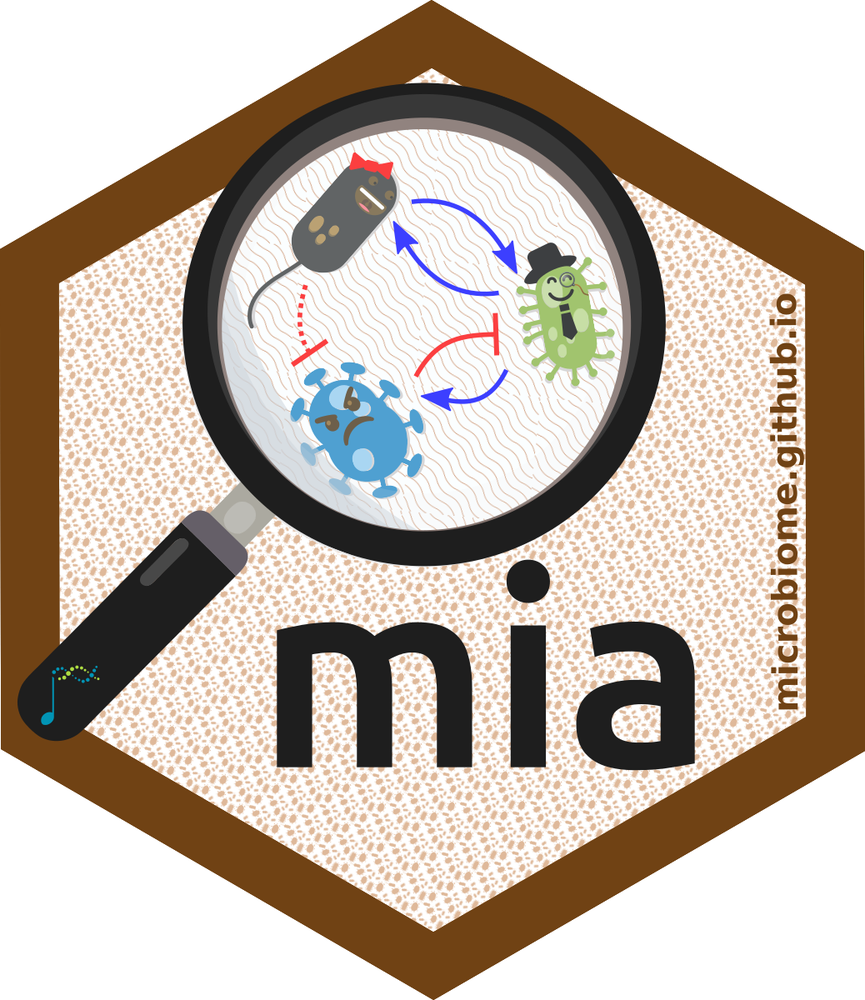
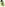
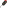

```{r}
people <- read.csv("data/contributors.csv", na.strings = "")
people <- people[order(sub(".* ", "", people$name)), ]

# Workshops from data/events.csv. Dates may be "2024", "2024-09" or "2024-09-18".
events <- read.csv("data/events.csv", na.strings = "",
                   colClasses = c(date = "character", registration = "character",
                                  registration_deadline = "character"))
precision <- nchar(events$date)
events$sort_date <- as.Date(substr(paste0(events$date, "-07-01"), 1, 10))
events$sort_date[precision == 7] <- as.Date(paste0(events$date[precision == 7], "-15"))
events$label <- ifelse(precision == 4, events$date, format(events$sort_date, "%b %Y"))
events$where <- ifelse(is.na(events$country), events$city,
                       ifelse(is.na(events$city), events$country,
                              paste0(events$city, ", ", events$country)))
# Whether a workshop is upcoming or has registration open is decided in the
# visitor's browser from today's date (scripts/globe.html), so the site does not
# need to be rebuilt when a date passes. Here we only prepare the data.
deadline <- as.Date(events$registration_deadline)
events$deadline_label <- ifelse(is.na(deadline), NA, format(deadline, "%d %b %Y"))
# Accept registration links written without "https://"
no_scheme <- !is.na(events$registration) & !grepl("^[a-z]+://", events$registration)
events$registration[no_scheme] <- paste0("https://", events$registration[no_scheme])
events <- events[order(events$sort_date, decreasing = TRUE), ]
events$id <- seq_len(nrow(events))
events$start <- format(events$sort_date)
events$deadline <- events$registration_deadline
```

::: {.band .hero}
::: band-inner
::: hero-text
<a class="bioc-badge" href="https://bioconductor.org">project</a>

<h1 class="hero-title">Orchestrating Microbiome Analysis with Bioconductor</h1>

::: lead
R/Bioconductor packages and an online book for the statistical analysis of
microbiome data, developed by the OMA consortium.
:::

::: cta-row
[Read the book](https://bioconductor.org/books/release/OMA/){.btn-oma .btn-white-oma}
[Get the packages](#packages){.btn-oma .btn-light-oma}
:::
:::

{.hero-logo fig-alt="mia hex logo"}
:::
:::

<nav class="section-nav" aria-label="Contents">
<a href="#book">Book</a>
<a href="#packages">Packages</a>
<a href="#material">Material</a>
<a href="#workshops">Workshops</a>
<a href="#publications">Publications</a>
<a href="#contributors">Contributors</a>
<a href="#contact">Contact</a>
</nav>

::: {.band #book}
::: band-inner
::: feature
::: {}
## The book

[*Orchestrating Microbiome Analysis with Bioconductor*](https://bioconductor.org/books/release/OMA/)
covers the whole workflow, from data import and wrangling to diversity,
differential abundance, multi-omics integration and machine learning, with
reproducible examples on real data. It is free to read online.

[Open the book](https://bioconductor.org/books/release/OMA/){.btn-oma .btn-gradient-oma}
:::

::: code-teaser
<span class="mascot mascot-hat" aria-hidden="true"><span class="mascot-body"><svg class="face" viewBox="0 0 600 884"><g class="eye wink"><circle cx="222" cy="228" r="28" fill="#fff" stroke="#000" stroke-width="7"/><circle class="pupil" cx="225" cy="232" r="12"/></g><g class="eye"><circle cx="312" cy="222" r="25" fill="#fff" stroke="#000" stroke-width="6"/><circle class="pupil" cx="315" cy="226" r="11"/></g></svg></span></span>

```r
BiocManager::install(c("mia", "miaViz"))

library(mia)
library(miaViz)

data("GlobalPatterns", package = "mia")
tse <- GlobalPatterns

tse <- transformAssay(tse, method = "relabundance")
tse <- addAlpha(tse, index = "shannon")
plotAbundanceDensity(tse, n = 10)
```
:::
:::
:::
:::

::: {.band .band-blue #packages}
::: band-inner
## Packages

The packages share one data container,
[TreeSummarizedExperiment](https://bioconductor.org/packages/TreeSummarizedExperiment),
so they work together and with the rest of Bioconductor.

::: card-grid
<a class="oma-card c-blue" href="https://microbiome.github.io/mia/"><span class="tag">Analysis</span><span class="card-title">mia</span><span class="card-text">Data containers, wrangling, transformations, diversity, ordination and clustering.</span></a>

<a class="oma-card c-blue" href="https://microbiome.github.io/miaViz/"><span class="tag">Visualization</span><span class="card-title">miaViz</span><span class="card-text">Abundance plots, trees and ordinations.</span></a>

<a class="oma-card c-blue" href="https://microbiome.github.io/miaTime/"><span class="tag">Time series</span><span class="card-title">miaTime</span><span class="card-text">Longitudinal and time-series analysis.</span></a>

<a class="oma-card c-blue" href="https://microbiome.github.io/miaSim/"><span class="tag">Simulation</span><span class="card-title">miaSim</span><span class="card-text">Simulation of microbial community dynamics.</span></a>

<a class="oma-card c-blue" href="https://miadash-microbiome.2.rahtiapp.fi/"><span class="tag">Interactive</span><span class="card-title">miaDash</span><span class="card-text">Web app for exploring data without code.</span></a>

<a class="oma-card c-green" href="https://bioconductor.org/packages/MGnifyR"><span class="tag">Data access</span><span class="card-title">MGnifyR</span><span class="card-text">Access to the EBI MGnify resource.</span></a>

<a class="oma-card c-green" href="https://bioconductor.org/packages/HoloFoodR"><span class="tag">Data access</span><span class="card-title">HoloFoodR</span><span class="card-text">Access to the HoloFood database.</span></a>

<a class="oma-card c-brown" href="https://bioconductor.org/packages/TreeSummarizedExperiment"><span class="tag">Data container</span><span class="card-title">TreeSummarized<wbr>Experiment</span><span class="card-text">Hierarchical, multi-table microbiome data.</span></a>
:::
:::
:::

::: {.band #material}
::: band-inner
## Slides and material

Our slides, posters and exercises are openly licensed. You are welcome to use
them in your own teaching, and improvements are always appreciated.

::: card-grid
<a class="oma-card c-blue" href="https://microbiome.github.io/outreach/"><span class="icon"><i class="bi bi-easel"></i></span><span class="card-title">Slides</span><span class="card-text">Quarto slide decks on data containers, diversity, differential abundance, multi-omics and more.</span></a>

<a class="oma-card c-green" href="https://github.com/microbiome/outreach/tree/main/posters"><span class="icon"><i class="bi bi-file-earmark-richtext"></i></span><span class="card-title">Posters</span><span class="card-text">Conference posters from EuroBioC, ISMB/ECCB, ISME and others.</span></a>

<a class="oma-card c-brown" href="https://www.youtube.com/playlist?list=PLjiXAZO27elAJEptP59BN3whVJ61XIkST"><span class="icon"><i class="bi bi-play-btn"></i></span><span class="card-title">Videos</span><span class="card-text">Short videos on microbiome data science with R and Bioconductor.</span></a>

<a class="oma-card c-blue" href="https://github.com/microbiome/outreach"><span class="icon"><i class="bi bi-github"></i></span><span class="card-title">Outreach repository</span><span class="card-text">Sources for all of the above, plus figures and logos. Pull requests welcome.</span></a>
:::
:::
:::

::: {.band .band-green #workshops}
::: band-inner
## Workshops

We teach microbiome data science with OMA at conferences, summer schools,
universities and companies. Drag or zoom the globe to explore, or pick a workshop from the list.

::: workshop-grid
<span class="mascot mascot-virus" aria-hidden="true"><span class="mascot-body"><span class="mascot-lift"><svg class="face" viewBox="0 0 600 606"><g transform="rotate(-43.4 230 229.5)"><path class="frown" d="M153 337Q222 267 309 335" fill="none" stroke="#422b0d" stroke-width="26" stroke-linecap="round"/><g class="o-mouth"><ellipse cx="231" cy="318" rx="26" ry="32" fill="#422b0d"/><ellipse cx="231" cy="336" rx="15" ry="9" fill="#ff6f7d"/></g><g class="eye-v"><circle class="sclera" cx="167" cy="230" r="34" fill="#fff" stroke="#422b0d" stroke-width="6"/><g class="look"><g class="iris"><circle cx="167" cy="230" r="31" fill="#422b0d"/><ellipse cx="159" cy="217" rx="9" ry="10" fill="#896024"/></g></g></g><g class="eye-v"><circle class="sclera" cx="293" cy="230" r="34" fill="#fff" stroke="#422b0d" stroke-width="6"/><g class="look"><g class="iris"><circle cx="293" cy="230" r="31" fill="#422b0d"/><ellipse cx="287" cy="216" rx="9" ry="10" fill="#896024"/></g></g></g><line class="brow brow-l" x1="122" y1="172" x2="201" y2="216" stroke="#422b0d" stroke-width="22" stroke-linecap="round"/><line class="brow brow-r" x1="338" y1="170" x2="282" y2="204" stroke="#422b0d" stroke-width="22" stroke-linecap="round"/></g></svg></span></span></span>

::: map-card
```{r}
#| output: asis
workshops <- events[, c("id", "title", "kind", "label", "where", "lat", "lon", "start",
                        "registration", "deadline", "deadline_label")]
cat('<div id="globe" role="img" aria-label="Globe showing workshop locations"></div>\n')
cat('<div class="globe-zoom"><button type="button" data-zoom="in" aria-label="Zoom in">+</button>',
    '<button type="button" data-zoom="out" aria-label="Zoom out">&minus;</button></div>\n',
    '<div class="globe-hint">Ctrl + scroll to zoom</div>\n')
cat("<script>window.omaEvents = ", jsonlite::toJSON(workshops), ";</script>\n", sep = "")
```
:::

::: recent
#### `r nrow(events)` workshops

[● Registration open]{.legend-open} [● Upcoming]{.legend-upcoming} [● Past]{.legend-past}

```{r}
#| output: asis
# A plain list by date; the browser regroups it into Upcoming / Past and marks
# open registrations (scripts/globe.html). This version is shown without JavaScript.
item <- function(i) {
  e <- events[i, ]
  meta <- paste(c(e$kind, e$label, e$where)[!is.na(c(e$kind, e$label, e$where))], collapse = " · ")
  sprintf('<div class="event%s" data-id="%d"><span class="dot"></span><span><span class="event-title">%s</span><span class="event-meta">%s</span></span></div>',
          if (is.na(e$lat)) " online" else "", e$id, e$title, meta)
}
cat('<div class="event-list">', vapply(seq_len(nrow(events)), item, ""), "</div>", sep = "\n")
```
:::
:::

[Would you like a workshop for your group or event? [Get in touch](#contact).]{.small-note}
:::
:::

::: {.band #publications}
::: band-inner
## Publications

```{r}
#| output: asis
# Publications from data/publications.bib, in the order of the file
pubs <- bibtex::read.bib("data/publications.bib")
# "Borman T, Benedetti G, Muluh G, …, Mallick H, Lahti L." Lists of more than
# eight authors show the first and last three.
authors <- function(a) {
  a <- vapply(seq_along(a), function(i) {
    given <- gsub("[^[:upper:]]", "", paste(a[i]$given, collapse = " "))
    paste(a[i]$family, given)
  }, "")
  if (length(a) > 8) a <- c(a[1:3], "…", a[(length(a) - 2):length(a)])
  paste0(paste(a, collapse = ", "), ".")
}
for (i in seq_along(pubs)) {
  p <- pubs[[i]]
  venue <- p$journal
  if (!is.null(p$volume)) venue <- paste0(venue, " ", p$volume, if (!is.null(p$pages)) paste0(":", p$pages))
  venue <- paste0(venue, if (!is.null(p$volume)) ", " else " ", p$year)
  if (!is.null(p$doi)) venue <- sprintf("%s · [doi:%s](https://doi.org/%s)", venue, p$doi, p$doi)
  cat("::: pub\n")
  if (!is.null(p$badge)) {
    cat(sprintf("[%s]{.pub-badge%s}\n\n", p$badge, if (!is.null(p$badgecolor)) paste0(" .", p$badgecolor) else ""))
  }
  cat(sprintf("**%s**\\\n%s\\\n[%s]{.venue}\n:::\n\n", p$title, authors(p$author), venue))
}
```

If you use OMA in your work, please cite the preprint.
:::
:::

::: {.band .band-blue #contributors}
::: band-inner
## Contributors

OMA is developed by the OMA consortium. Questions and ideas are welcome in the
[#miaverse channel on Bioconductor Zulip](https://community-bioc.zulipchat.com/),
and contributions to the [packages](https://github.com/microbiome) and the
[book](https://github.com/microbiome/OMA) through GitHub.

```{r}
#| output: asis
initials <- function(x) {
  parts <- strsplit(x, " ")[[1]]
  toupper(paste0(substr(parts[1], 1, 1), substr(parts[length(parts)], 1, 1)))
}
chip <- function(i) {
  p <- people[i, ]
  avatar <- if (!is.na(p$github)) {
    sprintf('', p$github)
  } else {
    initials(p$name)
  }
  link <- if (!is.na(p$github)) {
    paste0("https://github.com/", p$github)
  } else if (!is.na(p$orcid)) {
    paste0("https://orcid.org/", p$orcid)
  } else {
    NA
  }
  name <- if (is.na(link)) p$name else sprintf('<a href="%s">%s</a>', link, p$name)
  title <- if (is.na(p$affiliation)) p$name else paste0(p$name, ", ", p$affiliation)
  sprintf('<span class="person" title="%s"><span class="avatar">%s</span>%s</span>', title, avatar, name)
}
cat('<div class="people">', vapply(seq_len(nrow(people)), chip, ""), "</div>", sep = "\n")
```

[Missing from the list? Add yourself to
[`data/contributors.csv`](https://github.com/microbiome/microbiome.github.com/blob/master/data/contributors.csv).]{.small-note}
:::
:::


::: {.band .band-green #contact}
::: band-inner
## Contact

Questions, ideas, or interested in a workshop? Get in touch.

::: card-grid
<a class="oma-card c-green" href="https://community-bioc.zulipchat.com/"><span class="icon"><i class="bi bi-chat-dots"></i></span><span class="card-title">Bioconductor Zulip</span><span class="card-text">Chat with the team in the <strong>#miaverse</strong> channel of the Bioconductor community.</span></a>

<a class="oma-card c-blue" href="https://github.com/microbiome"><span class="icon"><i class="bi bi-github"></i></span><span class="card-title">GitHub</span><span class="card-text">Report issues and contribute to the packages, the book and this site.</span></a>
:::


:::
:::
